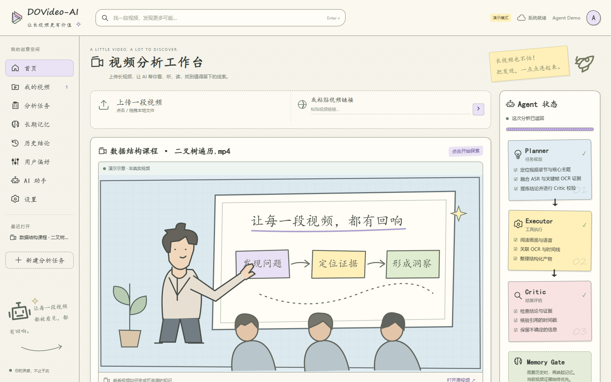
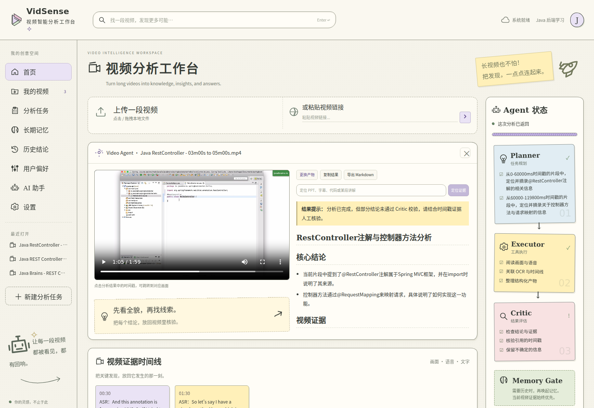
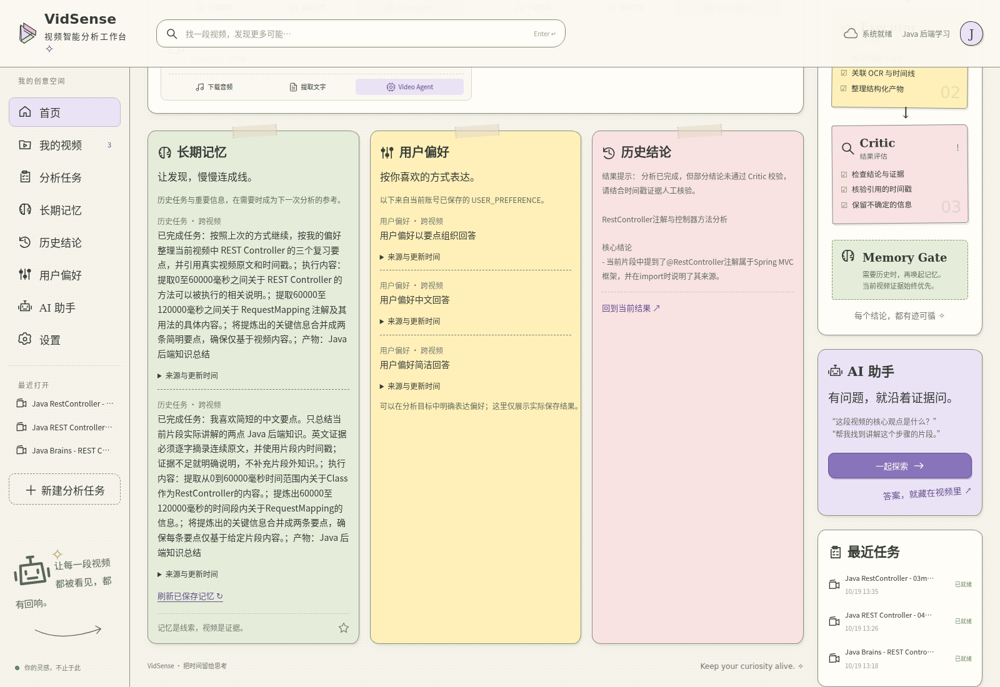
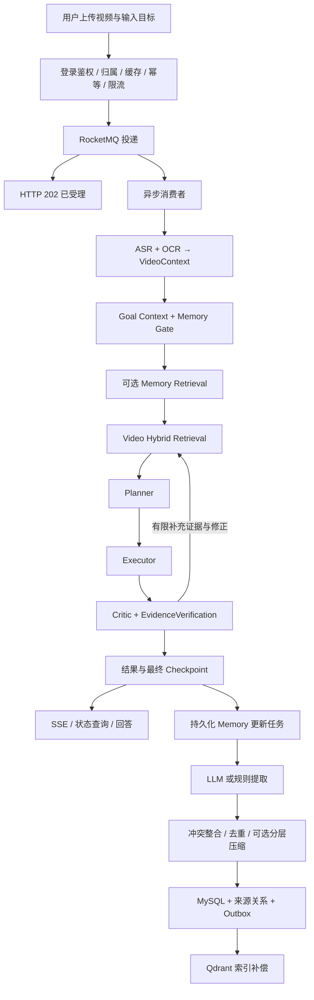

# VidSense

让长视频更有价值：把语音、画面文字和时间线组织成可检索、可追溯、可继续追问的知识。


这是基于 [Xiaoc7r/DOVideo-AI](https://github.com/Xiaoc7r/DOVideo-AI) 继续开发的公开版本，保留原有 Video Agent 架构，并增加手绘工作台、可选长期记忆及可靠性增强。原项目版权声明保留于 [LICENSE](LICENSE)。

## 当前界面

以下为**当前前端代码实际运行截图**，采用项目自带 `?demo` 演示数据；视频示意图、示例答案与运行状态用于展示界面，不代表这次截图执行了真实模型分析。没有使用上游旧截图。

**手绘风视频工作台**



**结构化分析、时间戳证据与 Planner / Executor / Critic**



<details>
<summary>长期记忆与偏好说明区域</summary>



当前这些前端卡片仍是说明/占位展示，并非完整的 Memory 管理界面；“用户偏好”示例不是已保存偏好。真实 Memory 读写、禁用、来源查询与补偿在后端实现。
</details>

## 能做什么

- **视频上传与管理**：本地文件、视频链接、分片上传与断点续传，MinIO 对象存储。
- **时序多模态上下文**：FFmpeg 音频分段与关键帧抽取，ASR + OCR 对齐到 `VideoContext`。
- **视频混合检索**：分块摘要、关键词和 Embedding，Qdrant 保存视频向量；不可用时降级。
- **有证据约束的 AgentLoop**：Planner 拆解任务，Executor 生成结构化产物，Critic 核验并有限重试。支持通用、学习、审查和创作模式，支持自动意图路由。
- **异步任务**：RocketMQ 提交后返回 HTTP 202；SSE/轮询展示进度，幂等、用户/全局限流、有限重投与失败任务台账。
- **恢复与复用**：MySQL Checkpoint 为恢复真源，Redis 为热缓存；按视频内容、目标和模式管理上下文、计划、执行状态及结果。
- **继续追问与计划修订**：围绕当前视频追问、定位证据、显式修改计划、反馈与重跑。
- **手绘风工作台**：纸张背景、低饱和便签、可复用 `PaperCard`、`SketchIcon`、证据时间线和 Agent 流程卡片。

### 可选长期记忆

长期记忆辅助当前任务，不替代视频证据，也不等于聊天记录或 Checkpoint。

| 能力 | 当前实现 |
|---|---|
| Memory Gate | 低成本规则判断历史依赖；普通视频事实查询跳过，不额外调用 LLM |
| 类型与作用域 | USER_PREFERENCE、EPISODIC_TASK、IMPORTANT_FACT、PREVIOUS_RESULT、USER_FEEDBACK；用户、视频、会话作用域隔离 |
| 存储与召回 | MySQL 权威原文/状态；独立 Qdrant Memory collection；语义相似度、重要性、时效综合排序，SQL 二次核验 |
| LLM 提取 | 结构化提取偏好、重要事实和反馈，字段/来源/置信度校验；规则降级可独立开关 |
| 语义整合 | 重复、更新、冲突、新记忆及不确定关系；明确用户纠正优先，保留禁用和退役墓碑，防止旧任务重放复活 |
| 分层压缩 | 对同用户、兼容作用域及主题的旧任务做保守抽取式整合，保留来源边；不是任意跨主题的自由生成摘要 |
| 异步更新 | 先保存最终 Checkpoint，再排队更新 Memory；持久化租约、重试、崩溃窗口恢复 |
| 向量补偿 | SQL outbox 驱动索引更新/删除与重建；MySQL/Qdrant 为最终一致，不宣称强一致 |
| 证据边界 | Prompt 区分 Current Task / Agent Memory / Video Evidence；视频事实以当前证据为准，Memory 不能直接生成时间戳证据 |

当前业务可靠提供的是 **Current Goal**；User Goal / Session Goal 没有可信来源时保持为空，不根据数据结构存在就视为完整的长期目标管理。Memory 相关失败采用 fail-open，继续原视频分析流程。

## 系统流程



上传、分析提交和后台执行是不同阶段。HTTP 202 表示已受理；结果缓存命中返回 200；重复活动任务返回 409，限流返回 429。后台失败仍需查询终态，不能由 202 推断成功。

## 技术栈

| 层次 | 技术 |
|---|---|
| 前端 | Vue 3、Vite、SSE、Marked、自定义手绘样式与组件 |
| 后端 | Java 21、Spring Boot 3.5.9、Undertow、MyBatis-Plus、Flyway |
| 中间件 | MySQL 8、Redis 7.4 / Redisson、RocketMQ 5.3.4、MinIO、Qdrant |
| 模型与媒体 | LangChain4j、OpenAI-compatible 接口、FFmpeg、Tesseract、ASR |
| 本地模型验收环境 | Qwen2.5 7B、Qwen3 Embedding 0.6B、faster-whisper；服务需自行准备 |

本仓库包含应用源码、测试、数据库迁移与部署模板，**不包含模型权重、Python 虚拟环境、Ollama/GPU 网关或 ASR 服务的服务器私有安装目录**。配置支持连接兼容服务，不意味着 clone 后自动安装这些服务。

## 快速开始

需要 JDK 21、Node.js 22+、Docker Compose v2、FFmpeg 和 Tesseract（建议安装 `chi_sim`、`eng`）；`yt-dlp` 仅视频链接导入需要。Windows 建议在 WSL2 中执行下面的 Bash 命令。

```bash
git clone https://github.com/187815118/DOVideo-AI.git
cd DOVideo-AI
cp .env.example .env
```

编辑 `.env`，替换所有 `change-*` 密码，保证 `DB_USERNAME` 与 `MYSQL_APP_USER` 相同，并配置模型服务。基础服务的随机强密码可以使用，但同一服务的客户端配置必须一致。应用注册/登录账号由系统用户表管理，与 MySQL、Redis、MinIO 的连接密码是不同概念。

模型可使用云端兼容接口，也可接入自建本地服务。使用本地服务时，例如：

```dotenv
SILICONFLOW_API_KEY=local-only
SILICONFLOW_BASE_URL=http://127.0.0.1:11434/v1
LLM_MODEL=qwen2.5:7b-instruct
EMBEDDING_MODEL=qwen3-embedding:0.6b
# 需另外部署兼容的音频转写服务；Ollama 本身不提供此 ASR 接口。
ASR_URL=http://127.0.0.1:19002/v1/audio/transcriptions
ASR_MODEL=your-asr-model
```

`local-only` 仅是无需鉴权的本地服务占位值，不是云端 API 密钥。LLM 与 Embedding 共用配置中的基础地址；需要不同端口/GPU 时，应自行部署兼容路由网关。Embedding 模型/维度改变后应使用兼容的 collection 或重新索引。英语专用 Whisper 模型不适合中文转写。

**启动基础服务：**

```bash
bash scripts/dev-up.sh
```

Docker 镜像标签若不可获取，可用本地 `compose.override.yml` 指定可用兼容镜像；该私有覆盖文件默认忽略，不修改业务接口。Compose 不会自动启动模型或 ASR。

**启动后端（终端一，从项目根目录）：**

```bash
set -a
source .env
set +a
cd server
./mvnw spring-boot:run
```

Flyway 执行 V1–V5；升级使用新 migration，不改写已应用的 V4。默认后端 `http://127.0.0.1:9090`：

```bash
curl http://127.0.0.1:9090/health
```

**启动前端（终端二，从项目根目录）：**

```bash
set -a
source .env
set +a
cd client
npm ci
npm run dev
```

访问 `http://localhost:5173`，注册/登录后上传视频。开发代理通过 `VITE_DEV_PROXY_TARGET` 连接后端。只看界面可访问 `http://localhost:5173/?demo`；演示模式不会验证真实 AI 链路。

### 开启长期记忆

在 `.env` 中按需设置，再重启自己的后端进程：

```dotenv
MEMORY_ENABLED=true
MEMORY_LLM_EXTRACTION_ENABLED=true
MEMORY_LLM_EXTRACTION_TIMEOUT_MS=10000
MEMORY_RULE_EXTRACTION_ENABLED=true
MEMORY_SEMANTIC_CONSOLIDATION_ENABLED=true
MEMORY_CONSOLIDATION_ENABLED=true
MEMORY_CONSOLIDATION_TRIGGER_COUNT=150
MEMORY_CONSOLIDATION_BATCH_SIZE=6
```

这些增强功能默认关闭，可分别启用。`MEMORY_ENABLED=false` 关闭运行期 Memory 检索、提取、写入和后台维护；正常的数据库结构迁移仍属于应用升级步骤。偏好可在分析目标中明确表达，例如“以后用中文、简短要点回答”；需要成功完成并通过校验后才进入提取流程，不是前端卡片点击即保存。

## 测试与实测

```bash
# 后端默认测试：包含 Mock/H2 测试，不是外部服务 E2E。
cd server
./mvnw test
./mvnw -DskipTests package
```

```bash
# 前端测试与构建：另开终端，从项目根目录执行。
cd client
npm ci
npm test
npm run build
```

Memory 真实服务测试需要显式提供隔离 MySQL、Qdrant、本地模型等条件，参见 [Memory 设计与验证边界](docs/memory-design.md)。不要在业务数据库中运行会清空夹具表的集成测试。

2026-10-19 低负载实测：真实分析提交返回 202 为 **95.57 ms**，约 **24.66 s** 后查询到完成，最终 Critic 通过；复用了 ASR/OCR 上下文。另在隔离实例使用只收件的消费者，50 次正式提交平均 **21.33 ms**、P95 **34.03 ms**、成功率 **100%**。这是提交响应延迟，不是 AI 分析吞吐或同步版本加速比。详见 [方法、条件及逐次原始数据](docs/performance.md)。

## 代码导航

```text
client/src/
  App.vue                    手绘工作台入口
  components/                PaperCard、AgentFlow、EvidenceTimeline 等
  styles/                    纸张主题和设计 token
  useAnalysisWorkspace.js    分析、追问、状态与结果交互
server/src/main/java/com/example/server/
  controller/                认证、媒体、分析与 Memory API
  consumer/                  RocketMQ 消费与重试
  service/                   VideoContext、检索、AgentLoop、Checkpoint
  memory/                    Gate、提取、整合、压缩、持久化与索引补偿
server/src/main/resources/db/migration/   V1–V5 数据库迁移
server/src/test/             后端测试及显式集成测试
docs/                        架构、学习资料与性能测试说明
```

更多说明：[Memory 设计](docs/memory-design.md) · [Memory 源码问答](docs/memory-interview-qa.md) · [公开发布范围](docs/public-release.md)。

CI 配置保留为 [.github/ci-template.yml](.github/ci-template.yml)，本次发布未自动启用 GitHub Actions；启用方式见公开发布说明。

## 来源与许可证

本版本基于 [Xiaoc7r/DOVideo-AI](https://github.com/Xiaoc7r/DOVideo-AI) 的实际工作区继续开发，不将上游已有能力描述为本版本从零实现。以当前源码为准；保留 MIT 许可证及原版权声明。公开仓库采用清理后的源码快照初始化，未上传旧服务器 Git 历史或运行数据。
